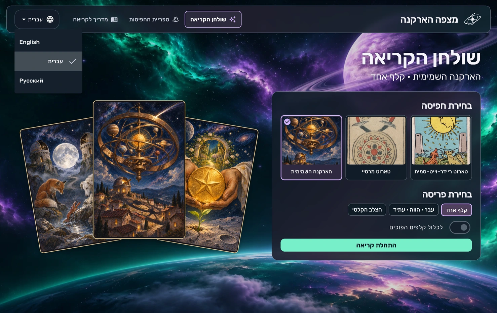

# Arcana Observatory

Arcana Observatory is a free, open-source tarot reader for Android and Windows x64. Choose a deck, pick cards from the shuffled fan, and turn them over one at a time. The illustrated decks and lessons work offline. Online readings add Gemini 4 Carbon interpretations in English, Hebrew, or Russian.

| Deck | What you can explore |
| --- | --- |
| Rider–Waite–Smith | Pamela Colman Smith's illustrated scenes, from the Pam-A printing |
| Tarot de Marseille | Jean-Pierre Payen's Avignon woodcuts, including the numbered suit patterns |
| Celestial Arcana | 78 original cosmic paintings with individual scene briefs |

Read a single card, follow a Past–Present–Future spread, or lay out the ten-card Celtic Cross. Reversals are optional. Enlarge a card to examine its symbols, or use the deck library to study the illustrations and meanings between readings.

Use the globe menu to choose **English**, **עברית**, or **Русский**. It updates the current reading, including the card names, interpretations and spread prompts. Hebrew uses a right-to-left layout. On first launch the app follows a supported device language and otherwise opens in English. It remembers your choice on this device.

### Reading with Gemini

Choose an online reading and optionally enter a question before drawing. Each reveal sends your question, language, deck, spread and revealed cards to the shared service. The service asks Gemini about the specific illustration, its position and orientation. You can keep drawing while it answers. The final card of a three-card spread or Celtic Cross also opens a whole-spread interpretation. A one-card reading has one integrated interpretation.

If your phone loses its connection or you switch apps, return to the open reading to pick up the answer. After four minutes the app offers **Check again** to look up the same request. Checking an accepted request uses no additional Gemini calls. The bundled lessons are available while you wait.

The service owner pays for up to 500 Gemini calls per UTC calendar month across all readers. A request in a new language counts toward that limit. The app remembers completed answers for the active reading. Choose offline mode to keep the reading on your device.



## Run an app

- **Windows 10/11 x64.** Extract the entire portable ZIP, then open `arcana_observatory.exe` in that folder.
- **Android 7.0 or later.** Open the preview APK on the device and follow Android's install prompt. CI signs each preview with a build-machine key. Android may require removing a differently signed preview before installing a new one.

Builds are available as artifacts on successful **Test and package** workflow runs. Sign in to GitHub to download the artifacts. [Builds](https://github.com/lubacareer/tarot/actions/workflows/build.yml)

## Build and test

Use Flutter 3.47.2, the Android SDK for APKs, and Visual Studio with the Desktop development with C++ workload for Windows. All artwork, fonts and offline lessons are in the checkout.

```sh
flutter pub get --enforce-lockfile
dart format --output=none --set-exit-if-changed lib test integration_test
flutter analyze
flutter test
python -m pip install Pillow==12.3.0
python -m unittest discover -s tools
flutter devices
```

Run the end-to-end suite with `flutter test integration_test -d windows` or use the Android device ID reported by `flutter devices`. Build an APK with `flutter build apk --release`. On Windows, run `flutter build windows --release` followed by `.\tool\package_windows.ps1`. The APK is under `build/app/outputs/flutter-apk/` and the portable ZIP is under `build/`.

### Run your own interpretation service

The Cloudflare Worker uses one SQLite-backed Durable Object to enforce the monthly allowance, limit bursts and deduplicate retries. It derives card meanings and positions from the bundled catalogs. Google receives the question and card context with interaction storage disabled. Each accepted request gives Gemini up to three minutes to answer. The app can retrieve the outcome with its private reading token for 24 hours. Application logs omit questions and interpretations.

For local development, put `GEMINI_API_KEY` in an ignored `.env` file at the project root. Use Node.js 22.13 or newer. From the `worker` directory, run:

```sh
npm ci
npm test
npm run dev -- --env-file ../.env
```

To use the local Worker from Windows, run `flutter run -d windows --dart-define=ARCANA_SERVICE_URL=http://127.0.0.1:8787`. For deployment, authenticate Wrangler to your Cloudflare account, run `npm run deploy`, then run `npx wrangler secret put GEMINI_API_KEY` and enter the key at the secure prompt. Use the deployed HTTPS origin as `ARCANA_SERVICE_URL` for your Flutter build. The official builds already use the project's hosted service. The Workers free plan supports the SQLite-backed Durable Object used here. [Cloudflare Durable Objects](https://developers.cloudflare.com/durable-objects/platform/pricing/) · [Gemini 4 Carbon](https://aistudio.google.com/docs/models/gemini-4-carbon)

## Art and licensing

Each deck's `faces.zip` contains 78 individually named WebPs. Open it with any ZIP utility to inspect the paintings. The neighboring `catalog.json` maps the filenames to card identities, English lessons, and credits. The `he.json` and `ru.json` files contain Hebrew and Russian text keyed by those same card IDs.

The code uses the MIT license. Original Celestial Arcana images, card backs and lessons use Creative Commons Attribution 4.0. The historical deck catalogs include provenance for each individual scan. Font notices ship with the app. [Code license](LICENSE) · [Artwork and font credits](ARTWORK-LICENSE.md)
